# 💡高性价比人生指南

每一条都回答两个问题：花掉什么，换回什么。

换回的算在谁头上也分档：你自己最高，其次配偶和直系亲属，再次朋友同事，陌生人最低——最低不等于零，只是回报的指望小、要连风险一起看。

不用全做：这是一份按性价比排好的备选单，不是任务清单。挑走一两条就算数，剩下的需要时再回来查——想挑省力的，左边把「花钱」选「不花钱」、「要毅力」选「不用」，剩下的就是。作者自己也没做到其中大部分。正文里带虚线的「第 X 条」可以点开，就地看那条写了什么，不用自己翻过去。

当前显示 665 条，共 665 条

**点击：**[下载 PDF 版本电子书，链接：https://pan.quark.cn/s/d30aa2b8da9f](https://pan.quark.cn/s/d30aa2b8da9f)

**点击：**[下载 EPUB 版本电子书，链接：https://pan.quark.cn/s/a213f2a9f69d](https://pan.quark.cn/s/a213f2a9f69d)

---
## 00-总览
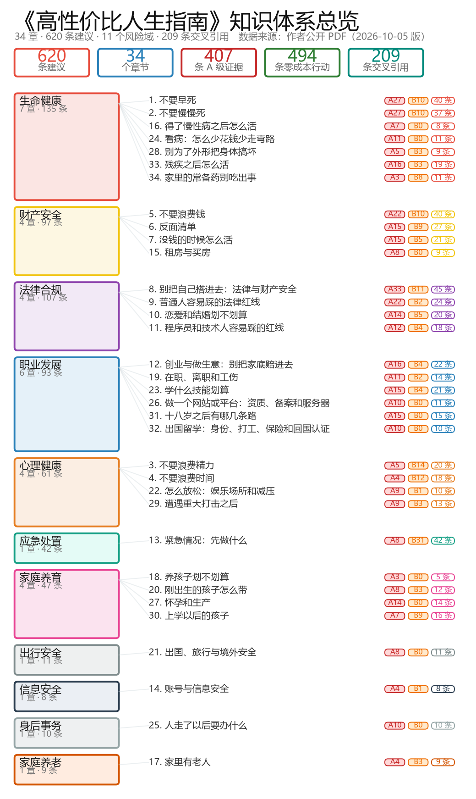
## 01-生命健康-1
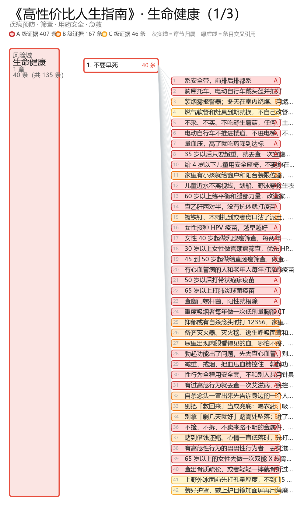
## 01-生命健康-2
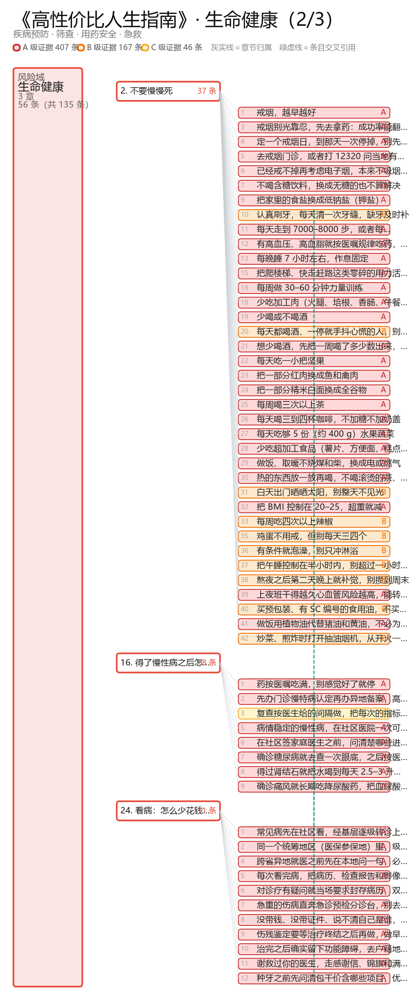
## 01-生命健康-3
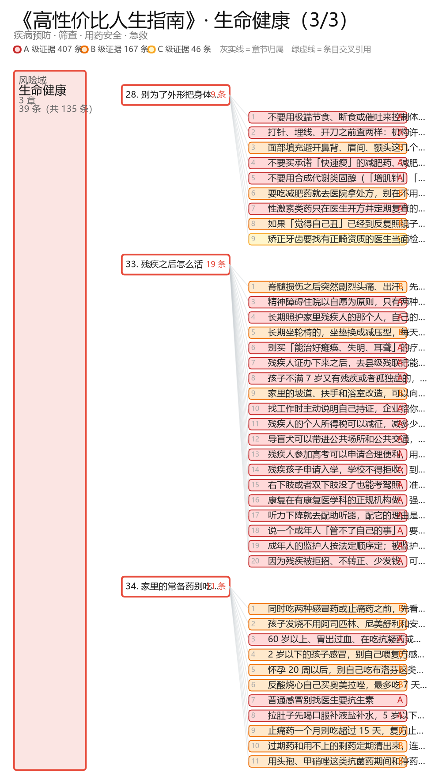
## 02-财产安全-1
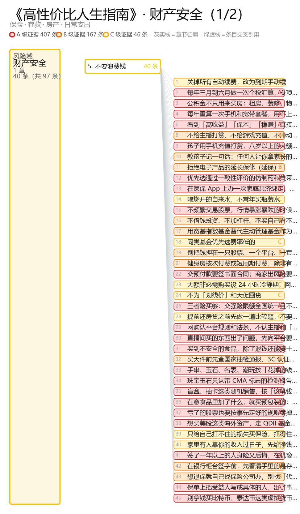
## 02-财产安全-2
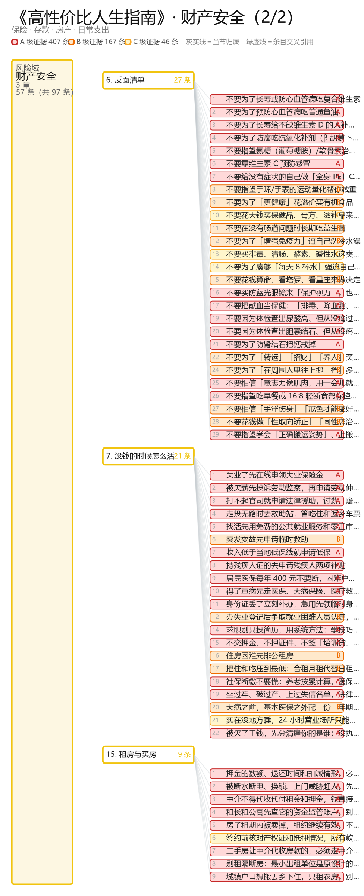
## 03-法律合规-1
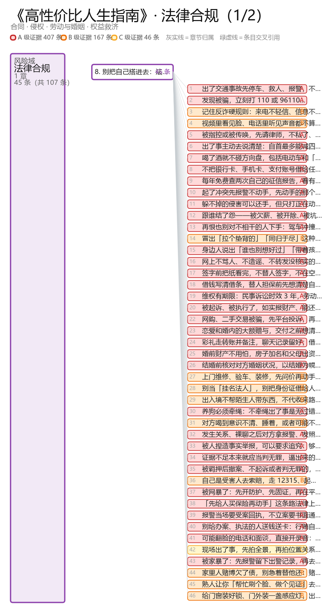
## 03-法律合规-2
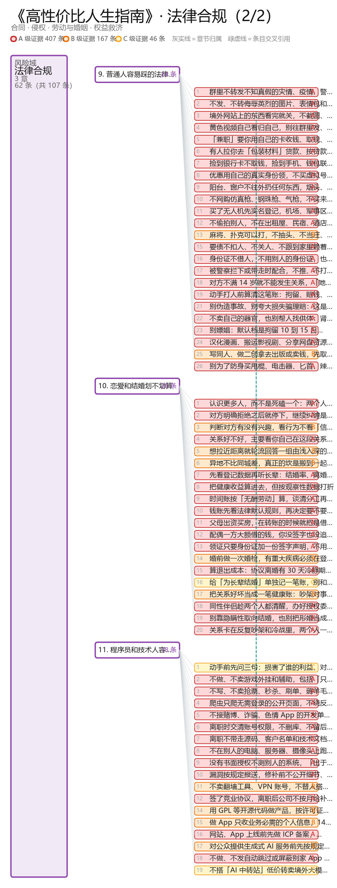
## 04-职业发展-1
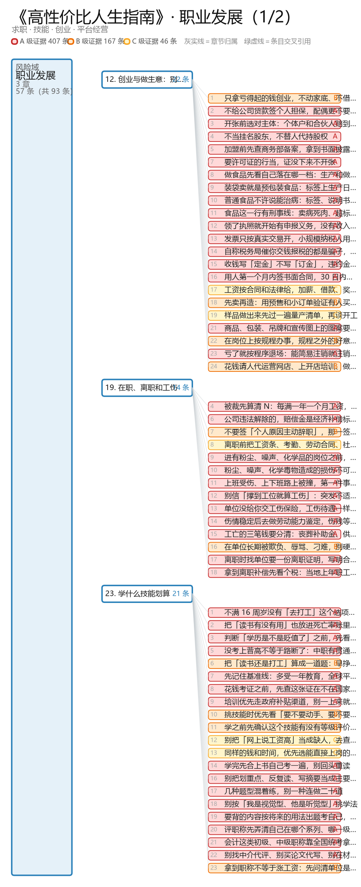
## 04-职业发展-2
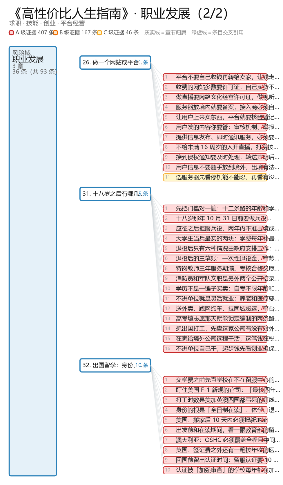
## 05-心理健康-1
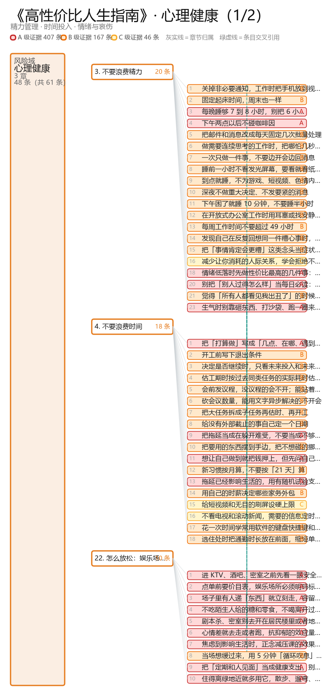
## 05-心理健康-2
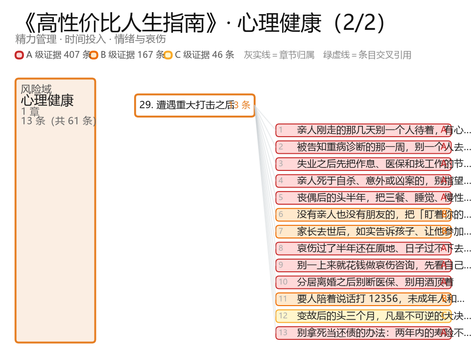
## 06-应急处置
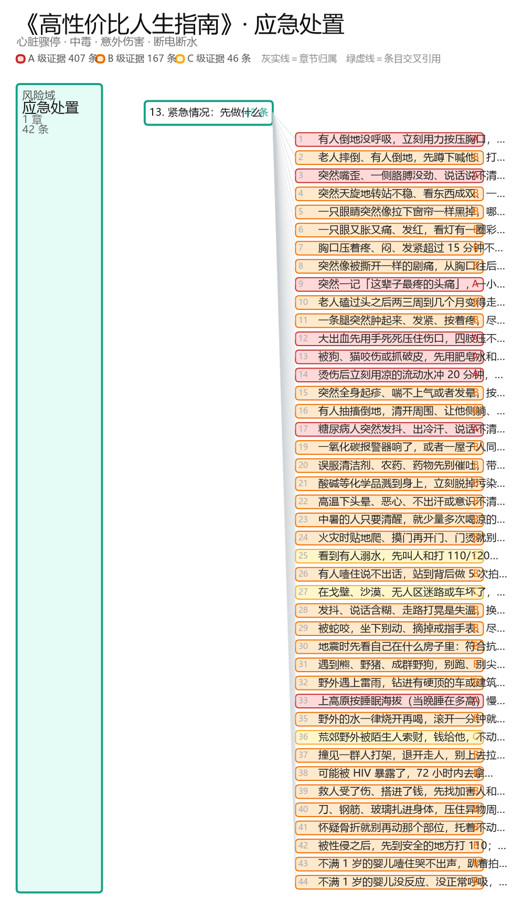
## 07-家庭养育
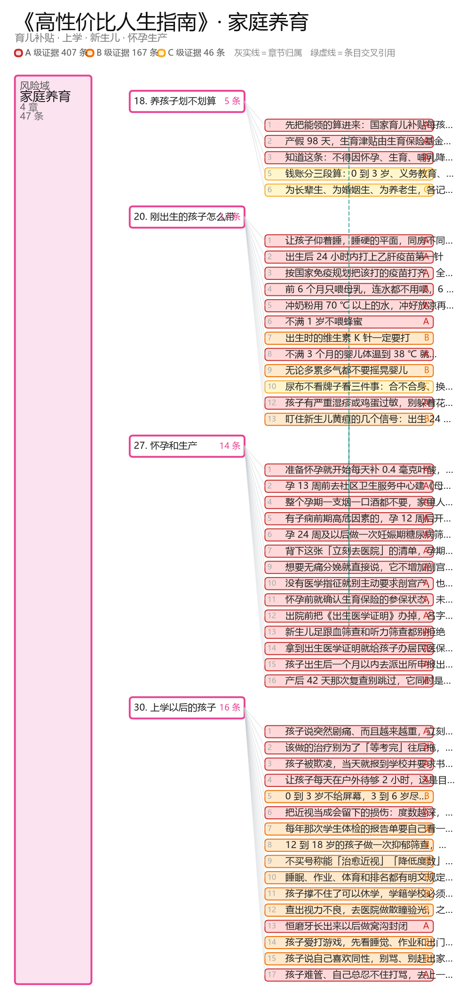
## 08-出行安全
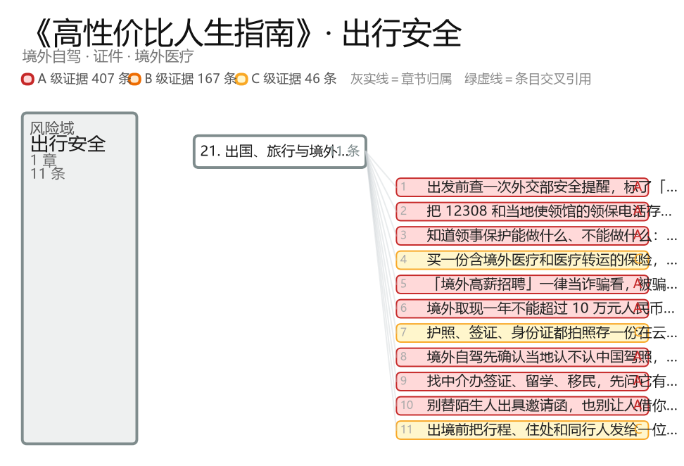
## 09-信息安全
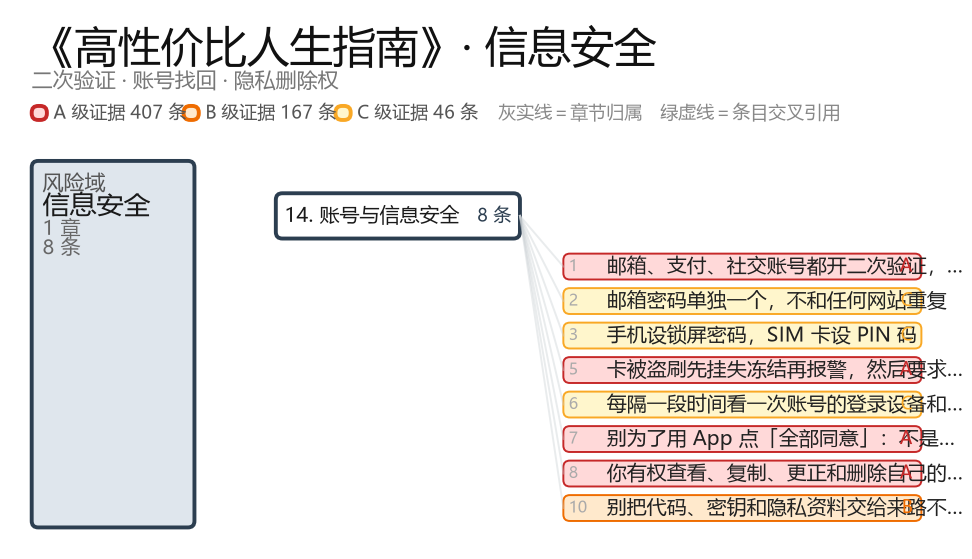
## 10-身后事务
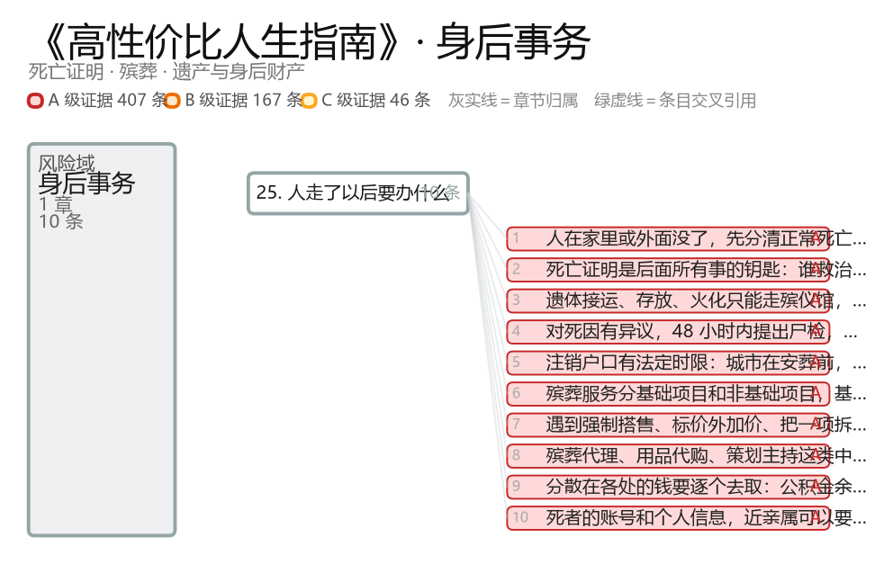
## 11-家庭养老
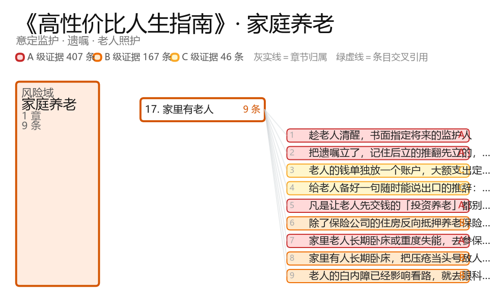
---

